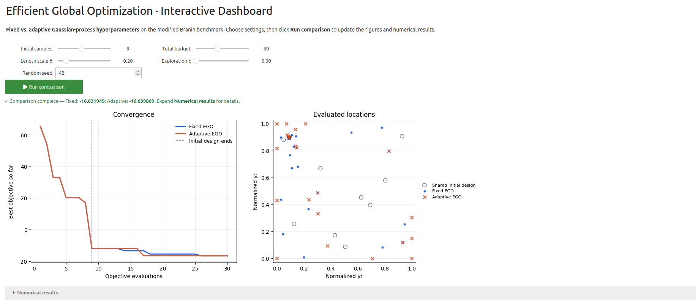

<div align="center">

# Efficient Global Optimization (EGO)

**Gaussian process-based global optimization using Expected Improvement**

Fixed and maximum-likelihood-adaptive surrogate models for bounded, expensive black-box objectives.

</div>

---

## Interactive Dashboard

Compare fixed and adaptive EGO through an interactive Jupyter/Voilà dashboard.

<div align="center">
<a href="https://mybinder.org/v2/gh/amalmach/Numerical-Optimization-and-Iterative-Methods/main?urlpath=voila%2Frender%2Fglobal_optimization%2Fnotebooks%2Fego_demo.ipynb"></a>
</div>



No local installation is needed to use the deployed dashboard. [Notebook source](../notebooks/ego_demo.ipynb).

---

## Overview

Efficient Global Optimization (EGO) selects new evaluations of a potentially costly objective by combining a Gaussian process surrogate with an Expected Improvement (EI) acquisition function. It balances searching regions with low predicted objective values against exploring regions with high predictive uncertainty.

| Configuration | Surrogate hyperparameters |
|:---|:---|
| **Fixed EGO** | Constant squared-exponential length scale and covariance amplitude |
| **Adaptive EGO** | Re-estimates both kernel parameters by Gaussian process marginal likelihood before each sequential evaluation |

The implementation uses Latin hypercube sampling, Cholesky-based Gaussian process regression, multistart L-BFGS-B acquisition maximization, a strict evaluation budget, and a reproducible random seed.

## 1. Mathematical Formulation

We seek to minimize an objective over a bounded domain:

<p align="center"></p>

### 1.1 Gaussian process surrogate

Given observations

<p align="center"></p>

the implementation uses a **zero-mean Gaussian process** with squared-exponential covariance:

<p align="center"></p>

Here, `theta` is the length scale and `sigma` is the covariance amplitude. For the regularized training covariance matrix `K`, the predictive mean and latent-function variance are

<p align="center"></p>

<p align="center"></p>

The implementation uses the kernel matrix augmented by a diagonal **nugget**, and calculates predictions with Cholesky solves rather than forming an explicit inverse. Negative predictive variances caused by floating-point roundoff are clipped to zero.

### 1.2 Expected Improvement

For minimization, the current incumbent is

<p align="center"></p>

For nonzero predictive standard deviation `s(x)`, Expected Improvement is

<p align="center"></p>

with

<p align="center"></p>

where `Phi` and `phi` denote the standard normal CDF and PDF, and `xi >= 0` is an exploration offset. At zero predictive standard deviation, the implementation uses the limiting formula

<p align="center"></p>

A new candidate is chosen by approximately maximizing EI over the normalized unit cube using multistart L-BFGS-B.

### 1.3 Adaptive hyperparameter estimation

The adaptive configuration estimates `theta` and `sigma` by minimizing the **zero-mean Gaussian process negative log marginal likelihood**:

<p align="center"></p>

The covariance matrix includes diagonal regularization. Optimization is performed over the logarithms of the two positive parameters with bounded L-BFGS-B. The current estimator uses one likelihood optimization start; a local result is not guaranteed to be globally optimal.

## 2. EGO Algorithm

1. Draw `n_initial` points using a seeded Latin hypercube design and evaluate the objective.
2. Transform training coordinates into the unit hypercube.
3. If adaptive mode is enabled, estimate the Gaussian process hyperparameters from the current observations.
4. Fit the Gaussian process to all observed values.
5. Maximize Expected Improvement using multiple local starts; avoid candidates too close to previously evaluated points.
6. Evaluate the objective at the selected candidate, append the observation, and update the best-so-far history.
7. Repeat until the **total** evaluation budget (including the initial design) is reached.

This approach does not require derivatives of the original black-box objective. The acquisition optimizer may use numerical derivatives internally.

## 3. Modified Branin Benchmark

The objective used in the reproducible example is the **modified** Branin function:

<p align="center"></p>

on the original domain

<p align="center"></p>

The additional linear term `5*x1` distinguishes this objective from the classical Branin function. Input normalization uses

<p align="center"></p>

## 4. Numerical Results

The comparison used `n_initial=9`, `max_evaluations=30` (21 sequential iterations), `theta=0.2`, `sigma=1.0`, `nugget=1e-8`, `xi=0`, `n_restarts=10`, and `random_state=42`.

| Metric | Fixed EGO | Adaptive EGO |
|:---|---:|---:|
| Initial best value | -11.92965549 | -11.92965549 |
| Final best value | -16.63194867 | **-16.63986869** |
| Best normalized `y1` | 0.09044073 | 0.08933318 |
| Best normalized `y2` | 0.89703340 | 0.90204874 |
| Objective evaluations | 30 | 30 |

Adaptive EGO obtained a lower final objective value by approximately `0.00792002` **in this single-seed experiment**. This does not prove that adaptive estimation is superior in general or that either run found the global minimizer.

## 5. Python Implementation

| File | Purpose |
|:---|:---|
| [`ego.py`](ego.py) | Sequential optimizer and `EGOResult` |
| [`gaussian_process.py`](gaussian_process.py) | Squared-exponential kernel and Gaussian process regression |
| [`acquisition.py`](acquisition.py) | Expected Improvement |
| [`hyperparameters.py`](hyperparameters.py) | Marginal likelihood and parameter estimation |
| [`benchmarks.py`](benchmarks.py) | Modified Branin objective |
| [`example.py`](example.py) | Fixed/adaptive reproducible comparison |
| [`test_ego.py`](test_ego.py) | Automated tests |

### Basic usage

```python
from global_optimization.ego import (
    efficient_global_optimization,
    modified_branin_normalized,
)


def objective(x):
    return float(modified_branin_normalized(x[0], x[1]))


result = efficient_global_optimization(
    objective=objective,
    bounds=[(0.0, 1.0), (0.0, 1.0)],
    n_initial=9,
    max_evaluations=30,
    random_state=42,
    estimate_parameters=True,
)

print("Best point:", result.x_best)
print("Best value:", result.f_best)
```

Use `estimate_parameters=False` for fixed EGO.

Run the example or tests from the repository root:

```bash
python -m global_optimization.ego.example
python -m pytest -v global_optimization/ego/test_ego.py
```

The current suite includes **17 passing tests**, covering benchmark calculations, kernel/GP predictions, EI, budgets, reproducibility, bounded candidates, and likelihood estimation.

## 6. Numerical Considerations

- **Stability:** Cholesky factorization avoids explicit covariance inversion; the nugget aids conditioning.
- **Scaling:** All GP input points are normalized to the unit cube, while output values retain their original scale.
- **Search limits:** L-BFGS-B can return local acquisition or likelihood optima; multistart acquisition search reduces but cannot remove this limitation.
- **Sampling:** Candidates too close to existing observations are replaced using a randomized pool.
- **Reproducibility:** A fixed seed reproduces initial points and acquisition starts in a compatible numerical environment.
- **Stopping:** The implementation exhausts the specified evaluation budget; it does not certify convergence to a global optimum.

## 7. References

1. Jones, D. R., Schonlau, M., and Welch, W. J. (1998). *Efficient Global Optimization of Expensive Black-Box Functions.* Journal of Global Optimization, **13**, 455–492.
2. Rasmussen, C. E., and Williams, C. K. I. (2006). *Gaussian Processes for Machine Learning.* MIT Press.
3. McKay, M. D., Beckman, R. J., and Conover, W. J. (1979). *A Comparison of Three Methods for Selecting Values of Input Variables in the Analysis of Output from a Computer Code.* Technometrics, **21**(2), 239–245.

---

<div align="center">

[⬅ Back to Global Optimization](../README.md)

</div>
