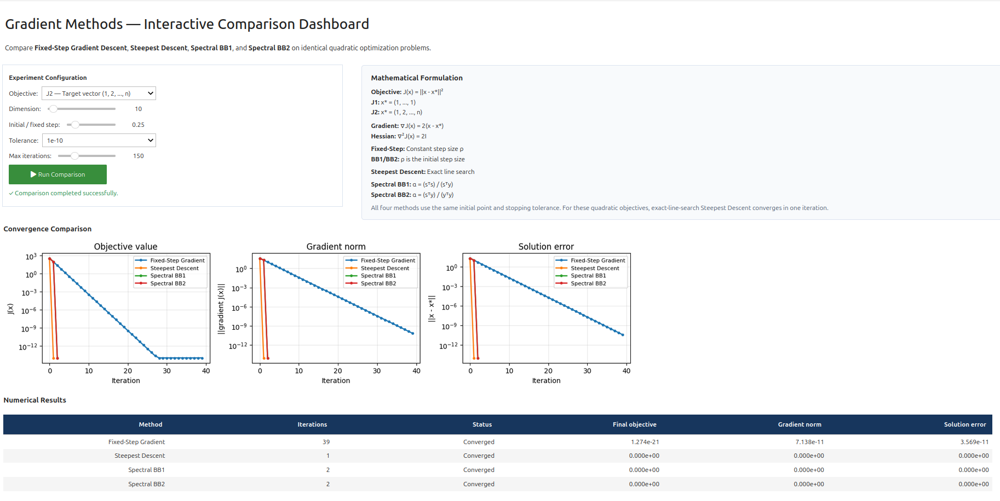

<div align="center">

# Gradient Methods

Numerical optimization algorithms for minimizing differentiable objective functions.

This directory contains reusable Python solvers, numerical tests, mathematical documentation, and interactive Jupyter/Voilà dashboards.

</div>

---

## Available Methods

| Method | Implementation | Documentation | Interactive Notebook | Voilà Dashboard |
|---|---|---|---|---|
| **Fixed-Step Gradient Descent** | [Solver](fixed_step_gradient_solver/FixedStepGradient.py) | [README](fixed_step_gradient_solver/README.md) | [Notebook](notebooks/fixed_step_gradient_demo.ipynb) | [Launch Dashboard](https://mybinder.org/v2/gh/amalmach/Numerical-Optimization-and-Iterative-Methods/main?urlpath=voila%2Frender%2Fgradient_methods%2Fnotebooks%2Ffixed_step_gradient_demo.ipynb) |
| **Steepest Descent** | [Solver](steepest_descent_solver/SteepestDescent.py) | [README](steepest_descent_solver/README.md) | [Notebook](notebooks/steepest_descent_demo.ipynb) | [Launch Dashboard](https://mybinder.org/v2/gh/amalmach/Numerical-Optimization-and-Iterative-Methods/main?urlpath=voila%2Frender%2Fgradient_methods%2Fnotebooks%2Fsteepest_descent_demo.ipynb) |
| **Spectral Gradient (BB1/BB2)** | [Solver](spectral_gradient_solver/SpectralGradient.py) | [README](spectral_gradient_solver/README.md) | [Notebook](notebooks/spectral_gradient_demo.ipynb) | [Launch Dashboard](https://mybinder.org/v2/gh/amalmach/Numerical-Optimization-and-Iterative-Methods/main?urlpath=voila%2Frender%2Fgradient_methods%2Fnotebooks%2Fspectral_gradient_demo.ipynb) |
| **Gradient Methods Comparison** | Fixed-Step vs Steepest Descent vs Spectral (BB1/BB2) | — | [Notebook](notebooks/gradient_methods_comparison_demo.ipynb) | [Launch Dashboard](https://mybinder.org/v2/gh/amalmach/Numerical-Optimization-and-Iterative-Methods/main?urlpath=voila%2Frender%2Fgradient_methods%2Fnotebooks%2Fgradient_methods_comparison_demo.ipynb) |

> Binder may require some time to initialize the environment on the first launch.

## Mathematical Overview

Both methods minimize a differentiable objective function:

<p align="center">$\displaystyle \min_{x \in \mathbb{R}^n} f(x).
$</p>

The general gradient iteration is:

<p align="center">$\displaystyle x_{k+1} = x_k - \alpha_k \nabla f(x_k).
$</p>

### Fixed-Step Gradient Descent

Uses a constant learning rate:

<p align="center">$\displaystyle \alpha_k = \alpha > 0.
$</p>

Its convergence depends on the objective function and the chosen step size.

### Steepest Descent

Uses the negative gradient as the search direction, with a step length determined by the algorithm:

<p align="center">$\displaystyle x_{k+1} = x_k - \alpha_k \nabla f(x_k).
$</p>

See the individual method documentation for implementation details and numerical experiments.

### Spectral Gradient (Barzilai–Borwein)

Uses information from successive iterates and gradients to estimate suitable step sizes.

Two variants are implemented:

- **BB1:** Uses the ratio of the squared step norm to the step-gradient inner product.
- **BB2:** Uses the ratio of the step-gradient inner product to the squared gradient-difference norm.

Unlike exact line search, spectral step sizes do not necessarily produce a decrease in the objective at every iteration.

See the [Spectral Gradient documentation](spectral_gradient_solver/README.md) for mathematical formulas, numerical safeguards, and experiments.

## Interactive Gradient Methods Comparison Dashboard

Compare **Fixed-Step Gradient Descent**, **Steepest Descent with Exact Line Search**, and the two **Barzilai–Borwein spectral gradient methods (BB1 and BB2)** on identical quadratic optimization problems.

The interactive dashboard provides shared experiment controls, convergence plots for objective values, gradient norms, and solution errors, and a numerical table comparing all four methods. A status indicator reminds users to rerun the comparison whenever parameters change.

[](https://mybinder.org/v2/gh/amalmach/Numerical-Optimization-and-Iterative-Methods/main?urlpath=voila%2Frender%2Fgradient_methods%2Fnotebooks%2Fgradient_methods_comparison_demo.ipynb)



**Notebook:** [gradient_methods_comparison_demo.ipynb](notebooks/gradient_methods_comparison_demo.ipynb)

> **Numerical note:** For the quadratic objectives used in this comparison, the Hessian is \(2I\). Consequently, exact-line-search Steepest Descent reaches the minimizer in one iteration (up to floating-point precision).

## Run the Tests

From the repository root:

```bash
python3 -m unittest gradient_methods.fixed_step_gradient_solver.test_fixed_step_gradient -v
python3 -m unittest gradient_methods.steepest_descent_solver.test_steepest_descent -v
python3 -m unittest gradient_methods.spectral_gradient_solver.test_spectral_gradient -v
```

## References

1. J. Nocedal and S. J. Wright, *Numerical Optimization*, Springer, 1999.

2. S. Boyd and L. Vandenberghe, *Convex Optimization*, Cambridge University Press, 2004.

3. J. R. Shewchuk, *An Introduction to the Conjugate Gradient Method Without the Agonizing Pain*, 1994.
   
---

<div align="center">

[⬅ Back to Main Repository](../README.md)

</div>
