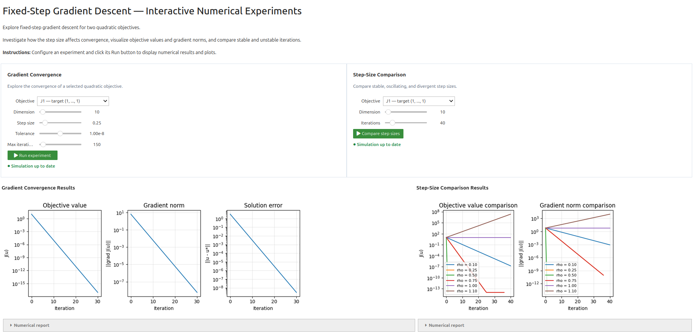

<div align="center">

# Fixed-Step Gradient Descent

A numerical implementation of gradient descent with a constant step size for unconstrained quadratic optimization.

Includes convergence diagnostics, numerical tests, and reproducible examples.

</div>

---

## Interactive Fixed-Step Gradient Dashboard

Explore fixed-step gradient descent through interactive experiments
for two quadratic objective functions.

Adjust the problem dimension, step size, and convergence tolerance.
Visualize objective values, gradient norms, and solution errors.
Compare convergent, oscillating, and divergent iterations.

[](https://mybinder.org/v2/gh/amalmach/Numerical-Optimization-and-Iterative-Methods/main?urlpath=voila%2Frender%2Fgradient_methods%2Fnotebooks%2Ffixed_step_gradient_demo.ipynb)



The dashboard runs in your browser using Binder and Voilà.
**No local installation is required.**

[Open the Jupyter notebook](../notebooks/fixed_step_gradient_demo.ipynb)
to inspect or modify the Python code.

> **Computational resources:** Binder provides limited CPU and memory.
> The first launch may require environment initialization.


---

### Main idea

The **Fixed-Step Gradient Descent** method minimizes a differentiable objective function by repeatedly moving in the negative gradient direction.

Starting from an initial approximation $u_0$, the method computes

$$
u_{k+1}=u_k-\rho\nabla J(u_k),
$$

where $\rho>0$ is a fixed step size.

Unlike line-search methods, the step size remains constant throughout the iterations.

The stopping criterion is

$$
\|\nabla J(u_k)\|_2\leq\varepsilon,
$$

where $\varepsilon$ is the prescribed gradient tolerance.

### Mathematical formulation

The implementation considers two quadratic objective functions.

#### First objective function

$$
J_1(u)=\sum_{i=1}^{N}(u_i-1)^2.
$$

Its gradient is

$$
\nabla J_1(u)=2(u-\mathbf{1}),
$$

where $\mathbf{1}=(1,\ldots,1)^T$.

The unique minimizer is

$$
u_1^*=\mathbf{1}.
$$

#### Second objective function

$$
J_2(u)=\sum_{i=1}^{N}(u_i-i)^2.
$$

Define

$$
\gamma=(1,2,\ldots,N)^T.
$$

The gradient is

$$
\nabla J_2(u)=2(u-\gamma).
$$

The unique minimizer is

$$
u_2^*=\gamma.
$$

### Convergence analysis

Both objectives can be written as

$$
J(u)=\|u-u^*\|_2^2.
$$

The gradient iteration becomes

$$
u_{k+1}=u_k-2\rho(u_k-u^*).
$$

Defining the error $e_k=u_k-u^*$ gives

$$
e_{k+1}=(1-2\rho)e_k.
$$

Consequently,

$$
e_k=(1-2\rho)^k e_0.
$$

For a nonoptimal initial point, convergence occurs precisely when

$$
\boxed{0<\rho<1}.
$$

The convergence factor is

$$
q=|1-2\rho|.
$$

For these two quadratic objectives:

- **$0<\rho<0.5$:** Convergence without sign oscillation.
- **$\rho=0.5$:** The minimizer is reached after one update in exact arithmetic.
- **$0.5<\rho<1$:** Convergence with alternating error signs.
- **$\rho=1$:** Persistent oscillation.
- **$\rho>1$:** Geometric divergence.

These convergence conditions are specific to the two implemented quadratic objectives.

### Algorithm

**Input:** Initial approximation $u_0$, fixed step size $\rho>0$, tolerance $\varepsilon$, maximum iteration count $K$, and objective selector $j\in\{1,2\}$.

1. Initialize the approximation $u_0$.
2. Evaluate $J_j(u_k)$ and $\nabla J_j(u_k)$.
3. Record the objective value and gradient norm.
4. Stop if the gradient tolerance is satisfied.
5. Otherwise, compute $u_{k+1}=u_k-\rho\nabla J_j(u_k)$.
6. Repeat until convergence or the maximum iteration count is reached.

The implementation also detects nonfinite objective values or gradient norms.

### Files

| File | Purpose |
|:---|:---|
| [FixedStepGradient.py](FixedStepGradient.py) | Numerical solver and objective functions |
| [test_fixed_step_gradient.py](test_fixed_step_gradient.py) | Numerical regression tests |
| [example.py](example.py) | Reproducible numerical experiments |
| [__init__.py](__init__.py) | Public package interface |
| [fixed_step_gradient_demo.ipynb](../    notebooks/fixed_step_gradient_demo.ipynb) | Original implementation and experiments |

### Python interface

Run the following example from the repository root:

```python
import numpy as np

from gradient_methods.fixed_step_gradient_solver import (
    solve_fixed_step_gradient,
)

result = solve_fixed_step_gradient(
    u0=np.zeros(10),
    rho=0.25,
    max_iter=1500,
    tol=1e-10,
    objective=1,
)

print("Converged:", result.converged)
print("Iterations:", result.iterations)
print("Solution:", result.solution)
print("Final gradient norm:", result.gradient_norms[-1])
```

The solver returns a `FixedStepGradientResult` containing the final solution, number of completed iterations, convergence status, objective history, gradient norms, and termination message.

The original `GF(u, rho, NbrIter, epsJ, k)` interface is also retained for compatibility.

### Numerical experiments

Run the reproducible example:

```bash
python3 -m gradient_methods.fixed_step_gradient_solver.example
```

Run the regression tests:

```bash
python3 -m unittest gradient_methods.fixed_step_gradient_solver.test_fixed_step_gradient -v
```

The experiments compare different fixed step sizes and demonstrate how they influence convergence.

### Numerical properties

- Uses first-order derivative information.
- Requires little working-vector storage.
- Avoids line-search computations.
- Is sensitive to the chosen fixed step size.
- Records objective values and gradient norms.
- Supports the two quadratic objectives from the original notebook.
- Reports convergence, iteration limits, and numerical divergence.

### References

1. J. Nocedal and S. J. Wright, *Numerical Optimization*, 2nd ed., Springer, 2006.
2. D. P. Bertsekas, *Nonlinear Programming*, 3rd ed., Athena Scientific, 2016.
3. Y. Nesterov, *Introductory Lectures on Convex Optimization: A Basic Course*, Kluwer Academic Publishers, 2004.
