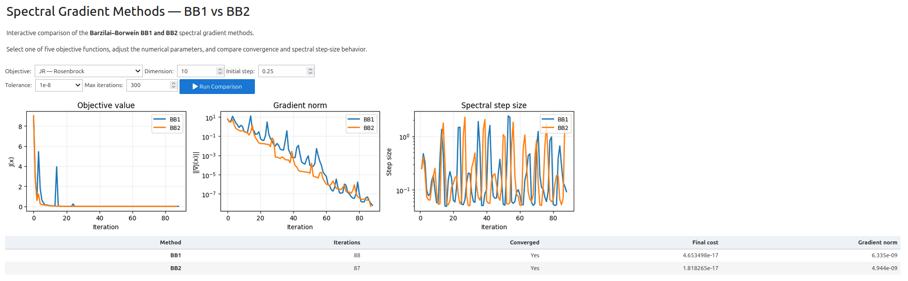

<div align="center">

# Spectral Gradient Methods

### Barzilai–Borwein BB1 and BB2

Python implementations of spectral gradient methods for unconstrained numerical optimization.

</div>

---

## Overview

Spectral gradient methods improve upon fixed-step gradient descent by selecting step sizes using information from successive iterates and gradients.

This module implements the two classical **Barzilai–Borwein methods**, BB1 and BB2.

The implementation supports five objective functions, convergence diagnostics, numerical safeguards, and automated regression tests.

## Interactive Dashboard

Launch the interactive BB1 versus BB2 dashboard:

[](https://mybinder.org/v2/gh/amalmach/Numerical-Optimization-and-Iterative-Methods/main?urlpath=voila%2Frender%2Fgradient_methods%2Fnotebooks%2Fspectral_gradient_demo.ipynb)

**Notebook:** [spectral_gradient_demo.ipynb](../notebooks/spectral_gradient_demo.ipynb)



### Features

- Five objective functions: J1, J2, J5, J6, and JR.
- Adjustable dimension, initial step, tolerance, and maximum iterations.
- BB1 versus BB2 convergence plots.
- Spectral step-size histories.
- Numerical comparison table.
- Manual execution using the **Run Comparison** button.
- Warning when parameters change.

> **Note:** The dashboard opens without plots. Results appear only after clicking **Run Comparison**.

## Mathematical Formulation

Consider the unconstrained optimization problem

<p align="center">$\displaystyle
\min_{x \in \mathbb{R}^n} J(x).
$</p>

The gradient iteration is

<p align="center">$\displaystyle
x_{k+1}=x_k-\alpha_k\nabla J(x_k).
$</p>

Define

<p align="center">$\displaystyle
s_{k-1}=x_k-x_{k-1},
\qquad
y_{k-1}=\nabla J(x_k)-\nabla J(x_{k-1}).
$</p>

### BB1 — First Barzilai–Borwein Step

<p align="center">$\displaystyle
\boxed{
\alpha_k^{BB1}=
\frac{s_{k-1}^{T}s_{k-1}}
{s_{k-1}^{T}y_{k-1}}
}
$</p>

### BB2 — Second Barzilai–Borwein Step

<p align="center">$\displaystyle
\boxed{
\alpha_k^{BB2}=
\frac{s_{k-1}^{T}y_{k-1}}
{y_{k-1}^{T}y_{k-1}}
}
$</p>

Both variants require an initial positive step size \(\alpha_0\).

Unlike line-search gradient methods, BB1 and BB2 do not necessarily decrease the objective function at every iteration.

## Supported Objective Functions

The solver supports five objectives from the original `SpectralStepGradient.ipynb` notebook.

### Quadratic Objectives

<p align="center">$\displaystyle
J_1(x)=\sum_{i=1}^{n}(x_i-1)^2
$</p>

<p align="center">$\displaystyle
J_2(x)=\sum_{i=1}^{n}(x_i-i)^2
$</p>

### Tridiagonal Quadratic Objective

<p align="center">$\displaystyle
J_5(x)=
\frac12 x^TAx-\mathbf{1}^Tx+\|x\|_2^2
$</p>

where

<p align="center">$\displaystyle
A=\operatorname{tridiag}(-1,2,-1).
$</p>

### Quartic-Regularized Objective

<p align="center">$\displaystyle
J_6(x)=
\frac12 x^TAx-\mathbf{1}^Tx+
\sum_{i=1}^{n}x_i^4.
$</p>

### Rosenbrock-Type Objective

<p align="center">$\displaystyle
J_R(x)=
\sum_{i=1}^{n-1}(x_{i+1}-x_i^2)^2
+
\sum_{i=1}^{n-1}(x_i-1)^2.
$</p>

The analytical gradients of all five objectives have been verified using central finite differences.

## Python Implementation

| File | Description |
|---|---|
| [SpectralGradient.py](SpectralGradient.py) | BB1 and BB2 numerical solvers |
| [objectives.py](objectives.py) | Objective functions and analytical gradients |
| [test_spectral_gradient.py](test_spectral_gradient.py) | Automated regression tests |
| [example.py](example.py) | Reproducible BB1 versus BB2 experiments |
| [__init__.py](__init__.py) | Public package interface |

### Example

```python
import numpy as np

from gradient_methods.spectral_gradient_solver import BB1, BB2

x0 = np.zeros(10)

result_bb1 = BB1(x0, rho=0.25, max_iter=300, tol=1e-8, objective=5)
result_bb2 = BB2(x0, rho=0.25, max_iter=300, tol=1e-8, objective=5)

print("BB1 iterations:", result_bb1.iterations)
print("BB2 iterations:", result_bb2.iterations)
print("BB1 converged:", result_bb1.converged)
print("BB2 converged:", result_bb2.converged)
```

Both functions return a `SpectralGradientResult` object containing the final solution, iteration count, convergence status, objective history, gradient-norm history, step-size history, and termination message.

## Numerical Safeguards

The implementation includes input validation, configurable step-size bounds, and detection of nonfinite iterates, objective values, and gradient norms.

If the spectral step-size calculation encounters invalid curvature or a zero denominator, the implementation falls back to the user-specified initial step size.

The stopping condition is

<p align="center">$\displaystyle
\|\nabla J(x_k)\|_2\leq \varepsilon.
$</p>

Convergence is not guaranteed for every objective function or parameter choice.

## Running the Examples and Tests

From the repository root, run:

```bash
python3 -m gradient_methods.spectral_gradient_solver.example
```

Run the automated regression tests:

```bash
python3 -m unittest gradient_methods.spectral_gradient_solver.test_spectral_gradient -v
```

## References

1. J. Barzilai and J. M. Borwein (1988). *Two-Point Step Size Gradient Methods*, IMA Journal of Numerical Analysis, 8(1), 141–148. 

2. J. Nocedal and S. J. Wright (1999). *Numerical Optimization*, Springer.

3. S. Boyd and L. Vandenberghe (2004). *Convex Optimization*, Cambridge University Press, 2004.

---

[⬅ Back to Gradient Methods](../README.md)
