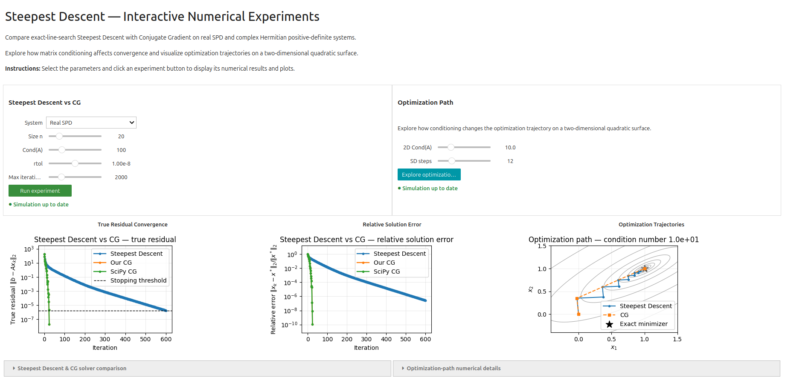

<div align="center">

# Steepest Descent Method

Exact-line-search Steepest Descent for real symmetric positive-definite and
complex Hermitian positive-definite linear systems, with numerical tests and
an interactive notebook.

</div>

## Interactive Steepest Descent Dashboard

Explore the Steepest Descent method through interactive numerical
experiments for real symmetric positive-definite and complex Hermitian
positive-definite linear systems.

Investigate exact line search for quadratic optimization, examine
the influence of matrix conditioning on convergence, and visualize
residual histories and solution errors. Compare convergence with
Conjugate Gradient to understand the differences between gradient
directions and conjugate search directions.

[](https://mybinder.org/v2/gh/amalmach/Numerical-Optimization-and-Iterative-Methods/main?urlpath=voila%2Frender%2Fgradient_methods%2Fnotebooks%2Fsteepest_descent_demo.ipynb)



The dashboard runs directly in your browser using Binder and Voilà.
**No local installation is required.**

The [Jupyter notebook](../notebooks/steepest_descent_demo.ipynb)
is also available for users who wish to inspect or modify the Python code.

> **Computational resources:** Binder provides limited CPU and memory
> resources. Larger systems or demanding experiments may take longer
> to execute. The first launch may also require environment initialization.

---

### Main idea

For a positive-definite system $Ax=b$, Steepest Descent can be interpreted as
minimization of a quadratic energy. In the real case,

<p align="center">$\displaystyle f(x)=\frac12 x^TAx-b^Tx.$</p>

The negative gradient is the residual,

<p align="center">$\displaystyle -\nabla f(x)=b-Ax=r.$</p>

The method moves along $r_k$ with an optimal step length. It is naturally
categorized as a **gradient-based optimization method**. CG, which uses
conjugate search directions, is a useful Krylov-method comparator.

For complex HPD systems use the real-valued energy

<p align="center">$\displaystyle f(x)=\frac12 x^HAx-\mathrm{Re}(b^Hx),$</p>

and replace transposes with conjugate transposes.

### Files

| File | Purpose |
|:---|:---|
| [SteepestDescent.py](SteepestDescent.py) | Solver with diagnostics and legacy dictionary interface |
| [test_steepest_descent.py](test_steepest_descent.py) | Regression tests, including complex and matrix-free systems |
| [example.py](example.py) | Reproducible demonstration and CG comparison |
| [Interactive notebook](../notebooks/steepest_descent_demo.ipynb) | Interactive numerical experiments |

### Mathematical formulation

Initialize $x_0$ and the residual

<p align="center">$\displaystyle r_0=b-Ax_0.$</p>

At iteration $k$, choose the steepest-descent direction

<p align="center">$\displaystyle p_k=r_k.$</p>

For a real SPD or complex HPD matrix, exact line search gives

<p align="center">$\displaystyle
\alpha_k=\frac{r_k^Hr_k}{r_k^HAr_k}.
$</p>

Update the approximation and residual:

<p align="center">$\displaystyle x_{k+1}=x_k+\alpha_k r_k,$</p>

<p align="center">$\displaystyle r_{k+1}=b-Ax_{k+1}.$</p>

The implementation checks the **true residual** using

<p align="center">$\displaystyle
\|b-Ax_k\|_2\leq\max(\mathrm{atol},\mathrm{rtol}\|b\|_2).
$</p>

### Algorithm

**Input:** SPD/HPD operator $A$, vector $b$, initial guess $x_0$,
absolute and relative tolerances, and iteration budget $N$.

1. Compute $r_0=b-Ax_0$ and check the residual tolerance.
2. For $k=0,1,\ldots,N-1$:
   - Compute $Ar_k$ and the curvature $r_k^HAr_k$.
   - Verify that the curvature is positive and numerically real.
   - Compute $\alpha_k=(r_k^Hr_k)/(r_k^HAr_k)$.
   - Update $x_{k+1}=x_k+\alpha_k r_k$.
   - Recompute the true residual $r_{k+1}=b-Ax_{k+1}$.
   - Stop if the tolerance is satisfied.
3. Return the approximation and convergence information.

### Numerical properties

- Requires $A$ to be real SPD or complex Hermitian positive definite.
- Uses one residual direction and needs little working-vector storage.
- Employs optimal line search along that direction, **not** global minimization.
- Often converges slowly for ill-conditioned matrices; residual norms and
  forward errors need not decrease at the same rate.
- Unlike CG, Steepest Descent generally does not converge in at most $n$
  steps in exact arithmetic.
- Matrix-free operators are assumed HPD. Only explicit dense arrays are
  validated directly using symmetry and Cholesky checks.

### Python interface

Run from the repository root (the directory containing `gradient_methods/`
and `krylov_methods/`):

```python
import numpy as np
from gradient_methods.steepest_descent_solver import solve_steepest_descent

A = np.array([[4., 1.], [1., 3.]])
b = np.array([1., 2.])
result = solve_steepest_descent(A, b, rtol=1e-10, atol=1e-12)
print(result.converged, result.iterations, result.solution)
```

The solver accepts NumPy arrays, SciPy sparse matrices,
`LinearOperator`, and matrix-vector callables. It returns a
`SteepestDescentResult` with `solution`, `iterations`, `converged`,
`residual_norms`, optional `history`, `breakdown`, and `message`.

The original `steepest_descent(A,b,tol=...,max_iter=...)` function remains
available and returns the original dictionary structure.

Install dependencies: `python -m pip install numpy scipy matplotlib ipywidgets`.

```bash
python3 -m unittest gradient_methods.steepest_descent_solver.test_steepest_descent -v
python3 -m gradient_methods.steepest_descent_solver.example
```

### Repository placement

This package belongs under `gradient_methods/`, while CG, GMRES, BiCGSTAB,
and symmetric Lanczos remain under `krylov_methods/`. A comparison notebook
can import both packages from the repository root. The notebook reuses the
shared reproducible-system and plotting helpers in
[`krylov_methods/notebooks/notebook_utils.py`](../../krylov_methods/notebooks/notebook_utils.py).

### References

1. J. Nocedal and S. J. Wright (2006), *Numerical Optimization*, 2nd ed., Springer.
2. Y. Saad (2003), *Iterative Methods for Sparse Linear Systems*, 2nd ed., SIAM.
3. J. R. Shewchuk (1994), *An Introduction to the Conjugate Gradient Method Without the Agonizing Pain*.
