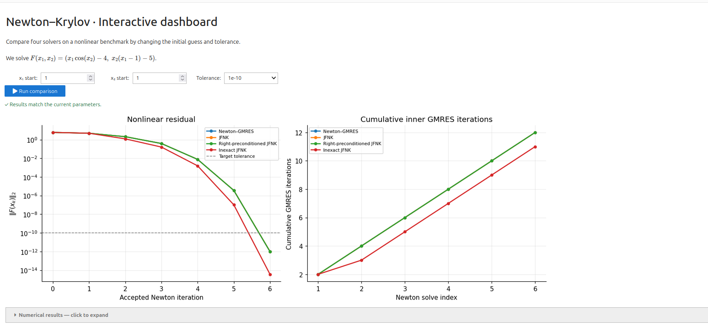

<div align="center">

# Newton–Krylov Methods

Python implementations of Newton–GMRES and Jacobian-free Newton–Krylov methods for solving nonlinear systems, with optional right preconditioning and adaptive inner solves.

</div>

---

## Interactive Dashboard

Compare **Newton–GMRES**, **JFNK**, **right-preconditioned JFNK**, and **inexact JFNK** on a two-variable nonlinear system. Choose the starting point and tolerance, then click **Run comparison** to view residual histories, cumulative GMRES iterations, and a numerical summary.

[](https://mybinder.org/v2/gh/amalmach/Numerical-Optimization-and-Iterative-Methods/main?urlpath=voila%2Frender%2Fnonlinear_solvers%2Fnotebooks%2Fnewton_krylov_demo.ipynb)



The dashboard runs directly in your browser using Binder and Voilà.
**No local installation is required.**

**Notebook source:** [newton_krylov_demo.ipynb](../notebooks/newton_krylov_demo.ipynb)

## Mathematical Formulation

Given a nonlinear system

<p align="center">
$\displaystyle F(x)=0, \qquad F:\mathbb{R}^n\to\mathbb{R}^n,$
</p>

Newton's method computes the correction $s_k$ from

<p align="center">
$\displaystyle J_F(x_k)s_k=-F(x_k), \qquad x_{k+1}=x_k+\alpha_k s_k,$
</p>

where $\alpha_k\in(0,1]$ is selected by backtracking. The linearized problem is solved approximately using GMRES.

### Jacobian-Free Newton–Krylov (JFNK)

Instead of assembling $J_F(x)$, the method approximates its action on a vector:

<p align="center">
$\displaystyle J_F(x)v\approx\frac{F(x+h v)-F(x)}{h}.$
</p>

The perturbation $h$ is scaled according to the iterate and the vector norm.

### Right Preconditioning

For a preconditioner $P_k$ approximating $J_F(x_k)$, GMRES solves

<p align="center">
$\displaystyle J_F(x_k)P_k^{-1}y_k=-F(x_k), \qquad s_k=P_k^{-1}y_k.$
</p>

The implementation accepts an **inverse-preconditioner action**, not an explicitly formed dense inverse.

### Inexact Newton–Krylov

The inner GMRES relative tolerance can vary with nonlinear progress. The included adaptive rule is a clipped residual-ratio heuristic, **not** a verbatim Eisenstat–Walker forcing formula.

## Supported Methods

| Method | Jacobian action | Preconditioning | GMRES tolerance |
|---|---|---|---|
| `newton_gmres` | User-supplied dense Jacobian | Optional right | Fixed |
| `jfnk` | Finite-difference Jacobian–vector products | Optional right | Fixed |
| `preconditioned_jfnk` | Finite-difference Jacobian–vector products | Required right | Fixed |
| `inexact_jfnk` | Finite-difference Jacobian–vector products | Optional right | Adaptive |

## Benchmark Nonlinear System

The demo solves

<p align="center">
  
</p>

using an adjustable starting point and tolerance. The default starting point is $x_0=(1,1)^T$.

## Python Implementation

| File | Description |
|---|---|
| [`newton_krylov.py`](newton_krylov.py) | Shared solver engine and four solver interfaces |
| [`example.py`](example.py) | Command-line numerical comparison |
| [`test_newton_krylov.py`](test_newton_krylov.py) | Automated tests |
| [`newton_krylov_demo.ipynb`](../notebooks/newton_krylov_demo.ipynb) | Interactive dashboard and plots |

### Example

```python
import numpy as np
from nonlinear_solvers.newton_krylov.newton_krylov import jfnk

def F(x):
    return np.array([x[0] * np.cos(x[1]) - 4, x[1] * (x[0] - 1) - 5])

result = jfnk(F, np.array([1.0, 1.0]))
print(result.converged, result.x, result.residual_norms[-1])
```

The returned `NewtonKrylovResult` includes the solution, convergence status, nonlinear residual history, Newton and GMRES iteration counts, forcing terms, step lengths, and termination message.

## Numerical Safeguards and Limitations

The solver checks initial inputs and finite function values, verifies the reconstructed linear correction, and uses backtracking on $\tfrac12\|F(x)\|_2^2$.

Convergence is not guaranteed from arbitrary starting points.

Finite-difference Jacobian products introduce approximation error; the current explicit-Jacobian interface expects dense arrays.

GMRES counts are callback iterations, **not** runtime or matrix–vector-product counts.

## Running the Examples and Tests

Install shared dependencies **from the repository root**:

```bash
python -m pip install -r requirements.txt
```

Run the command-line example and tests:

```bash
python nonlinear_solvers/newton_krylov/example.py
python -m pytest -q nonlinear_solvers/newton_krylov/test_newton_krylov.py
```

For the dashboard with hidden code cells locally, launch **Voilà from the repository root**:

```bash
python -m voila nonlinear_solvers/notebooks/newton_krylov_demo.ipynb
```


## References

1. Y. Saad and M. H. Schultz (1986). *GMRES: A Generalized Minimal Residual Algorithm for Solving Nonsymmetric Linear Systems*. SIAM Journal on Scientific and Statistical Computing, 7(3), 856–869.
2. D. A. Knoll and D. E. Keyes (2004). *Jacobian-free Newton–Krylov methods: a survey of approaches and applications*. Journal of Computational Physics, 193(2), 357–397.
3. J. Nocedal and S. J. Wright (1999). *Numerical Optimization*, Springer.

---

<div align="center">

[⬅ Back to Nonlinear Solvers](../README.md)

</div>
